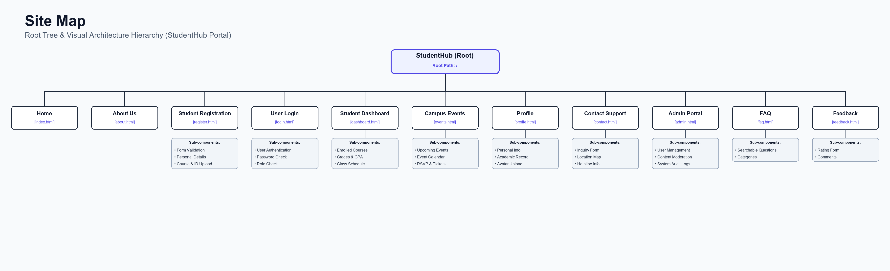

# StudentHub Portal - Practical 1 & 2 Setup
**Course:** Web Development Frameworks (ITUE203)  
**Semester:** 3rd Semester, 2026-27 (ODD)  
**Institution:** Devang Patel Institute of Advance Technology and Research (DEPSTAR), CHARUSAT  

---

## 1. Project Overview & Problem Definition

**StudentHub** is a central web portal designed to streamline campus activities, academic updates, event management, and student services into a single unified platform. 

### Key Modules:
1. **Public Portal:** Home, About Us, FAQ, Contact Us, Feedback.
2. **Authentication:** Student Registration, User Login.
3. **Student Portal:** Personal Dashboard, Profile Page, Campus Events.
4. **Administration:** Admin Dashboard for managing records and events.

### Target User Roles:
* **Guest / Visitor:** Can view home content, about page, FAQs, campus events, and send inquiry/feedback messages.
* **Registered Student:** Can log in, access student dashboard, update profile information, and browse events.
* **Administrator:** Accesses admin dashboard to monitor system stats and manage users/events.

---

## 2. Practical 1 Analysis & Questions

### Q1: What is a URL and what are its parts?
A **URL** (Uniform Resource Locator) is a web address used to locate a specific resource on the Internet.
* Example: `https://www.studenthub.edu:443/pages/events.html?category=sports#upcoming`
* **Components:**
  1. `https://` — **Protocol** (Hypertext Transfer Protocol Secure).
  2. `www.studenthub.edu` — **Domain Name / Host**.
  3. `:443` — **Port Number** (Default HTTPS port).
  4. `/pages/events.html` — **Resource Path**.
  5. `?category=sports` — **Query String / Parameters**.
  6. `#upcoming` — **Fragment / Anchor ID**.

### Q2: How is an HTML file processed in a web browser?
1. **Fetch & Download:** The browser requests the HTML document from the server via HTTP.
2. **HTML Parsing:** The browser reads raw HTML bytes, converts them into characters, tokens, and nodes.
3. **DOM Tree Construction:** Nodes are arranged into a tree structure called the **Document Object Model (DOM)**.
4. **CSSOM Construction:** The browser parses CSS to form the CSS Object Model (CSSOM).
5. **Render Tree & Layout:** DOM and CSSOM combine into a Render Tree to calculate exact element dimensions and screen coordinates.
6. **Painting:** The browser renders visual pixels onto the viewport.

### Q3: How is page navigation flow managed among all HTML pages?
Navigation is managed using **relative file paths** in HTML hyperlink (`<a>`) tags. Every page shares a consistent top `<nav>` bar linking to all major sections (`index.html`, `dashboard.html`, `events.html`, etc.), allowing smooth transitions without dead ends.

### Q4: How will GitHub commits be maintained after each practical?
Commits will follow a structured practical-wise naming convention:
* `feat(prac1): initial project setup, readme, sitemap, wireframes`
* `feat(prac2): added semantic HTML5 skeletons for 11 pages`
* `feat(prac3): applied responsive CSS grid and flexbox layout`
* `feat(prac4): added DOM interactivity and theme toggle`

---

## 3. Project Sitemap

```text
StudentHub Root (/)
│
├── index.html            [Home Page]
├── README.md             [Project Documentation & Report]
├── pages/                [Secondary Pages Directory]
│   ├── about.html        [About Portal & Vision]
│   ├── register.html     [Student Registration Form]
│   ├── login.html        [User Login Form]
│   ├── dashboard.html    [Student Dashboard]
│   ├── events.html       [Campus Events Listing]
│   ├── profile.html      [Student Profile]
│   ├── contact.html      [Contact & Location Info]
│   ├── admin.html        [Admin Dashboard]
│   ├── faq.html          [Frequently Asked Questions]
│   └── feedback.html     [Feedback & Survey Form]
└── assets/               [Static Assets Directory]
    ├── css/              [CSS Stylesheets (future proof)]
    ├── js/               [JavaScript Files (future proof)]
    └── images/           [Image Assets (sitemaps, wireframes)]
```

---

## 4. Low-Fidelity Wireframes & Visual Architecture Diagram


*Sitemap Formats:* [Sitemap PNG](file:///e:/SEM%203/Web%20Development/assets/images/studenthub_sitemap.png) | [Sitemap JPEG](file:///e:/SEM%203/Web%20Development/assets/images/studenthub_sitemap.jpg)

---

## 5. Directory & File Structure

```text
Web Development/
│
├── index.html                           # Home Page (Entry point)
├── README.md                            # Practical 1 documentation & report
├── Practical_List_ITUE203_WDF_2026_27.pdf
├── generate_all_wireframes.py           # Wireframes generator Python script
├── generate_highres_sitemap.py          # Sitemap generator Python script
│
├── pages/                               # Secondary pages directory
│   ├── about.html                       # About Page
│   ├── register.html                    # Registration Page
│   ├── login.html                       # Login Page
│   ├── dashboard.html                   # Student Dashboard Page
│   ├── events.html                      # Events Page
│   ├── profile.html                     # Profile Page
│   ├── contact.html                     # Contact Page
│   ├── admin.html                       # Admin Page
│   ├── faq.html                         # FAQ Page
│   └── feedback.html                    # Feedback Page
│
├── assets/                              # Core assets directory
│   ├── css/                             # Stylesheets (for future CSS)
│   ├── js/                              # Script files (for future JavaScript)
│   └── images/                          # Image assets
│       ├── studenthub_sitemap.png       # Main sitemap diagram (PNG)
│       ├── studenthub_sitemap.jpg       # Main sitemap diagram (JPEG)
│       ├── studenthub_all_11_wireframes.png # Collage of all wireframes (PNG)
│       └── studenthub_all_11_wireframes.jpg # Collage of all wireframes (JPEG)
│
└── practice/                            # Practice folder (Left alone)
```

---

## 6. Practical 2 Analysis & Questions

### Q1: Are semantic tags such as `<header>`, `<nav>`, `<main>`, `<section>`, `<article>`, `<aside>`, and `<footer>` used properly?
Yes. The tags are applied following their semantic definitions:
* `<header>` wraps the introductory content (site name, course title, and institute logo).
* `<nav>` is used exclusively for primary navigation blocks and breadcrumbs.
* `<main>` holds the primary, unique content of each page, marking it for screen readers and keyboard skip links.
* `<section>` groups related thematic content block elements.
* `<article>` wraps self-contained content modules (like news announcements or specific event entries).
* `<aside>` represents tangential or supplementary information (such as registration notices, map widgets, and support logs).
* `<footer>` represents page metadata, copyrights, and return-to-top links.

### Q2: Are form labels, headings, image alt text, and navigation links accessible?
Yes. Accessibility features implemented include:
1. **Explicit Form Labels:** Every input control is wrapped in or mapped directly to a `<label>` element using matching `for` and `id` properties to support screen reader text-to-speech.
2. **Logical Headings:** Headings follow a strict descending hierarchy (e.g. `<h1>` -> `<h2>` -> `<h3>`) with exactly one `<h1>` per page.
3. **Descriptive Alt Text:** All images contain informative descriptive attributes (e.g. `alt="Web Innovation Hackathon Banner"`).
4. **Skip-to-Content & Focus Ring:** Screen readers and keyboard-only users can jump directly to the unique body contents using the "Skip to main content" shortcut. Default browser outline styles are preserved for keyboard focus visual feedback.
5. **No CSS Elements:** The website structure is built strictly with HTML5 semantic guidelines as per Practical 2, without styling sheets.

### Q3: Is the page structure consistent across all pages?
Yes, all 11 pages share the exact same structural template (Header -> Navigation -> Breadcrumbs -> Main Content containing sections/asides -> Footer), ensuring a highly predictable and easy-to-use user experience.

---

## 7. Practical 2 Accessibility Checklist

- [x] **Skip-to-Content:** A skip-to-content link exists as the very first child of `<body>` on all 11 pages.
- [x] **Accessible Main Target:** Every `<main>` container has `id="main-content"` and `tabindex="-1"` to properly capture screen reader focus.
- [x] **Breadcrumb Navigation:** Breadcrumbs are added just below the main navigation lists to support intermediate site tracking.
- [x] **Keyboard-Friendly Outlines:** Focus indicators are preserved via standard browser outline defaults to maintain accessibility.
- [x] **Semantic Tags:** A complete set of semantic tags (`<header>`, `<nav>`, `<main>`, `<section>`, `<article>`, `<aside>`, `<footer>`) is used correctly across all pages.
- [x] **Explicit Form Labels:** All input, select, and textarea fields are explicitly bound to corresponding labels.
- [x] **Language Attribute:** Every document contains `<html lang="en">` to set the screen reader language dictionary.
- [x] **Descriptive Alt Attributes:** All site images contain readable, contextual alternative text descriptions.
- [x] **SEO Meta Descriptions:** Proper page titles and specific search descriptions are set in every document head.
