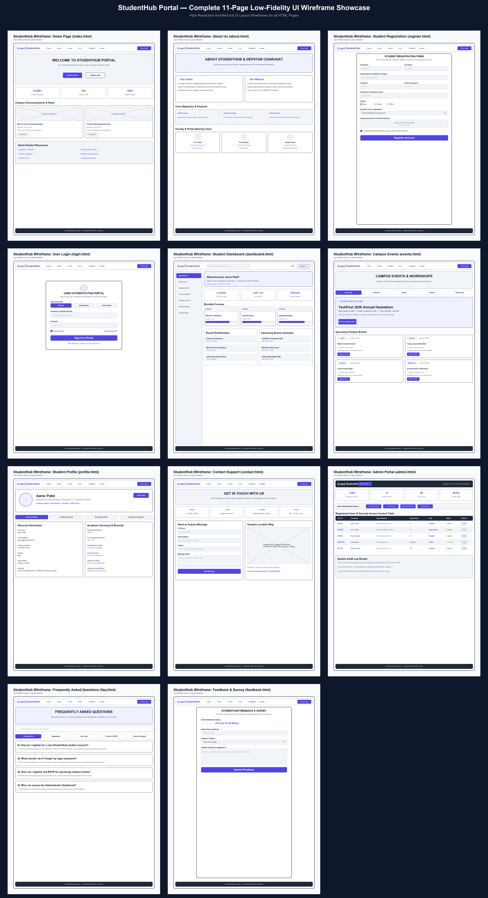

# StudentHub Portal - Practical 1 & 2 Setup
**Course:** Web Development Frameworks (ITUE203)  
**Semester:** 3rd Semester, 2026-27 (ODD)  
**Institution:** Devang Patel Institute of Advance Technology and Research (DEPSTAR), CHARUSAT  

---

## 1. Project Overview & Problem Definition

**StudentHub** is a central web portal designed to streamline campus activities, academic updates, event management, and student services into a single unified platform. 

### Key Modules:
1. **Public Portal:** Home, About Us, FAQ, Contact Us, Feedback.
2. **Authentication:** Student Registration, User Login.
3. **Student Portal:** Personal Dashboard, Profile Page, Campus Events.
4. **Administration:** Admin Dashboard for managing records and events.

### Target User Roles:
* **Guest / Visitor:** Can view home content, about page, FAQs, campus events, and send inquiry/feedback messages.
* **Registered Student:** Can log in, access student dashboard, update profile information, and browse events.
* **Administrator:** Accesses admin dashboard to monitor system stats and manage users/events.

---

## 2. Practical 1 Analysis & Questions

### Q1: What is a URL and what are its parts?
A **URL** (Uniform Resource Locator) is a web address used to locate a specific resource on the Internet.
* Example: `https://www.studenthub.edu:443/pages/events.html?category=sports#upcoming`
* **Components:**
  1. `https://` — **Protocol** (Hypertext Transfer Protocol Secure).
  2. `www.studenthub.edu` — **Domain Name / Host**.
  3. `:443` — **Port Number** (Default HTTPS port).
  4. `/pages/events.html` — **Resource Path**.
  5. `?category=sports` — **Query String / Parameters**.
  6. `#upcoming` — **Fragment / Anchor ID**.

### Q2: How is an HTML file processed in a web browser?
1. **Fetch & Download:** The browser requests the HTML document from the server via HTTP.
2. **HTML Parsing:** The browser reads raw HTML bytes, converts them into characters, tokens, and nodes.
3. **DOM Tree Construction:** Nodes are arranged into a tree structure called the **Document Object Model (DOM)**.
4. **CSSOM Construction:** The browser parses CSS to form the CSS Object Model (CSSOM).
5. **Render Tree & Layout:** DOM and CSSOM combine into a Render Tree to calculate exact element dimensions and screen coordinates.
6. **Painting:** The browser renders visual pixels onto the viewport.

### Q3: How is page navigation flow managed among all HTML pages?
Navigation is managed using **relative file paths** in HTML hyperlink (`<a>`) tags. Every page shares a consistent top `<nav>` bar linking to all major sections (`index.html`, `dashboard.html`, `events.html`, etc.), allowing smooth transitions without dead ends.

### Q4: How will GitHub commits be maintained after each practical?
Commits will follow a structured practical-wise naming convention:
* `feat(prac1): initial project setup, readme, sitemap, wireframes`
* `feat(prac2): added semantic HTML5 skeletons for 11 pages`
* `feat(prac3): applied responsive CSS grid and flexbox layout`
* `feat(prac4): added DOM interactivity and theme toggle`

---

## 3. Project Sitemap

```text
StudentHub Root (/)
│
├── index.html            [Home Page]
├── README.md             [Project Documentation & Report]
├── pages/                [Secondary Pages Directory]
│   ├── about.html        [About Portal & Vision]
│   ├── register.html     [Student Registration Form]
│   ├── login.html        [User Login Form]
│   ├── dashboard.html    [Student Dashboard]
│   ├── events.html       [Campus Events Listing]
│   ├── profile.html      [Student Profile]
│   ├── contact.html      [Contact & Location Info]
│   ├── admin.html        [Admin Dashboard]
│   ├── faq.html          [Frequently Asked Questions]
│   └── feedback.html     [Feedback & Survey Form]
└── assets/               [Static Assets Directory]
    ├── css/              [CSS Stylesheets (future proof)]
    ├── js/               [JavaScript Files (future proof)]
    └── images/           [Image Assets (sitemaps, wireframes)]
```

---

## 4. Low-Fidelity Wireframes & Visual Architecture Diagram


### 4.1 Home Page Layout (`index.html`)
```text
+-------------------------------------------------------------------+
|  [Logo] StudentHub     Home | About | Register | Login | Events... |
+-------------------------------------------------------------------+
|                                                                   |
|   WELCOME TO STUDENTHUB PORTAL                                    |
|   Your one-stop destination for campus news, events & profile.    |
|   [Explore Events]  [Student Login]                               |
|                                                                   |
+-------------------------------------------------------------------+
|  Announcement Section               | Quick Links                 |
|  - Mid-term exam schedule released  | - Student Registration      |
|  - Tech Fest 2026 registration open | - FAQ & Support             |
+-------------------------------------------------------------------+
|  Footer: (c) 2026 StudentHub - CHARUSAT DEPSTAR ITUE203               |
+-------------------------------------------------------------------+
```

### 4.2 Student Registration Form (`register.html`)
```text
+-------------------------------------------------------------------+
|  [Logo] StudentHub     Home | About | Register | Login | Events... |
+-------------------------------------------------------------------+
|                                                                   |
|   STUDENT REGISTRATION FORM                                       |
|   -------------------------------------------------------------   |
|   Full Name:     [________________________]                       |
|   Email Address: [________________________]                       |
|   Password:      [________________________]                       |
|   Gender:        ( ) Male  ( ) Female  ( ) Other                  |
|   Course:        [ Select Course  v ]                             |
|   [x] I agree to the terms and conditions                         |
|   [ Register Account ]                                            |
|                                                                   |
+-------------------------------------------------------------------+
|  Footer: (c) 2026 StudentHub                                      |
+-------------------------------------------------------------------+
```

### 4.3 Student Dashboard (`dashboard.html`)
```text
+-------------------------------------------------------------------+
|  [Logo] StudentHub     Home | Dashboard | Profile | Events | Login|
+-------------------------------------------------------------------+
|                                                                   |
|   STUDENT DASHBOARD                                               |
|   Welcome back, Student!                                          |
|                                                                   |
|   +-------------------+  +-------------------+  +---------------+ |
|   | Enrolled Courses  |  | Upcoming Events   |  | Notifications | |
|   | 5 Courses Active  |  | 3 Events Joined   |  | 2 New Alerts  | |
|   +-------------------+  +-------------------+  +---------------+ |
|                                                                   |
### 4.4 Complete 11-Page Low-Fidelity UI Wireframe Showcase



#### Individual Page Wireframe Diagrams:
1. **Home Page (`index.html`)**: [01_index_wireframe.png](file:///e:/SEM%203/Web%20Development/assets/images/wireframes/01_index_wireframe.png)
2. **About Us (`about.html`)**: [02_about_wireframe.png](file:///e:/SEM%203/Web%20Development/assets/images/wireframes/02_about_wireframe.png)
3. **Student Registration (`register.html`)**: [03_register_wireframe.png](file:///e:/SEM%203/Web%20Development/assets/images/wireframes/03_register_wireframe.png)
4. **User Login (`login.html`)**: [04_login_wireframe.png](file:///e:/SEM%203/Web%20Development/assets/images/wireframes/04_login_wireframe.png)
5. **Student Dashboard (`dashboard.html`)**: [05_dashboard_wireframe.png](file:///e:/SEM%203/Web%20Development/assets/images/wireframes/05_dashboard_wireframe.png)
6. **Campus Events (`events.html`)**: [06_events_wireframe.png](file:///e:/SEM%203/Web%20Development/assets/images/wireframes/06_events_wireframe.png)
7. **Student Profile (`profile.html`)**: [07_profile_wireframe.png](file:///e:/SEM%203/Web%20Development/assets/images/wireframes/07_profile_wireframe.png)
8. **Contact Support (`contact.html`)**: [08_contact_wireframe.png](file:///e:/SEM%203/Web%20Development/assets/images/wireframes/08_contact_wireframe.png)
9. **Admin Portal (`admin.html`)**: [09_admin_wireframe.png](file:///e:/SEM%203/Web%20Development/assets/images/wireframes/09_admin_wireframe.png)
10. **Frequently Asked Questions (`faq.html`)**: [10_faq_wireframe.png](file:///e:/SEM%203/Web%20Development/assets/images/wireframes/10_faq_wireframe.png)
11. **Feedback & Survey (`feedback.html`)**: [11_feedback_wireframe.png](file:///e:/SEM%203/Web%20Development/assets/images/wireframes/11_feedback_wireframe.png)

---

## 5. Directory & File Structure

```text
Web Development/
│
├── index.html                           # Home Page (Entry point)
├── README.md                            # Practical 1 documentation & report
├── Practical_List_ITUE203_WDF_2026_27.pdf
├── generate_all_wireframes.py           # Wireframes generator Python script
├── generate_highres_sitemap.py          # Sitemap generator Python script
│
├── pages/                               # Secondary pages directory
│   ├── about.html                       # About Page
│   ├── register.html                    # Registration Page
│   ├── login.html                       # Login Page
│   ├── dashboard.html                   # Student Dashboard Page
│   ├── events.html                      # Events Page
│   ├── profile.html                     # Profile Page
│   ├── contact.html                     # Contact Page
│   ├── admin.html                       # Admin Page
│   ├── faq.html                         # FAQ Page
│   └── feedback.html                    # Feedback Page
│
├── assets/                              # Core assets directory
│   ├── css/                             # Stylesheets (for future CSS)
│   ├── js/                              # Script files (for future JavaScript)
│   └── images/                          # Image assets
│       ├── studenthub_sitemap.png       # Main sitemap diagram
│       ├── studenthub_all_11_wireframes.png # Collage of all wireframes
│       └── wireframes/                  # Individual wireframe images
│
└── practice/                            # Practice folder (Left alone)
```
